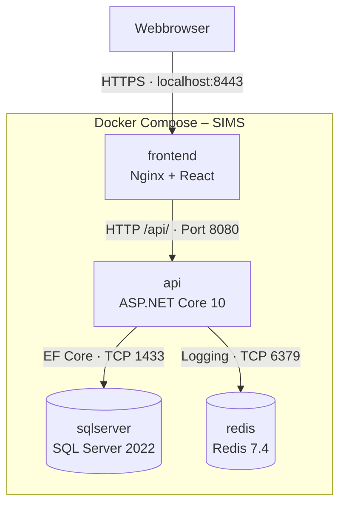
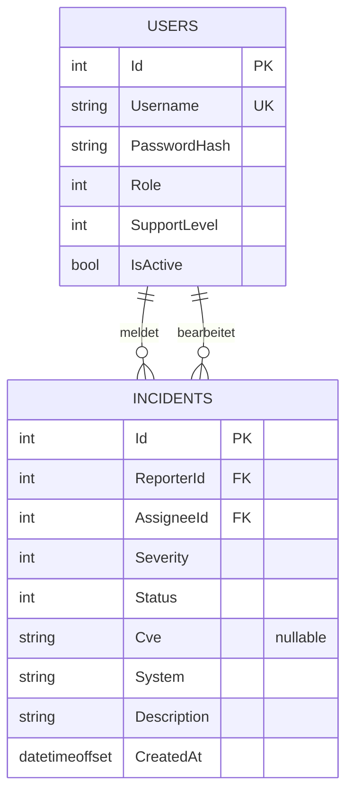
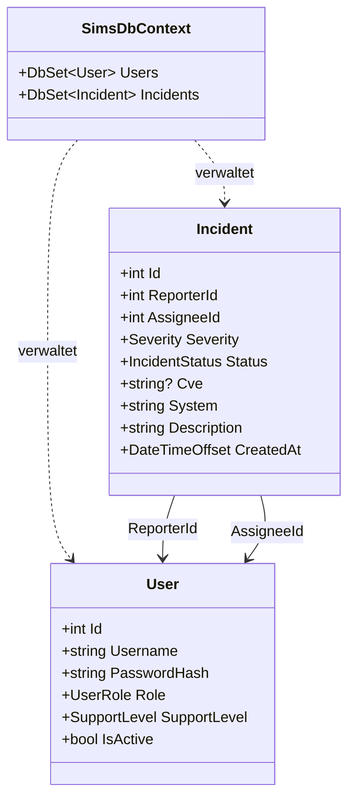

**# SIMS – Security Incident Management System**


![Status]\(https\://badgen.net/badge/Status/Demo%20bereit/green)

![Version]\(https\://badgen.net/badge/Version/1.0.0/blue)

![.NET]\(https\://badgen.net/badge/.NET/10/purple)

![React]\(https\://badgen.net/badge/Frontend/React%20%2B%20TypeScript/blue)

![Docker]\(https\://badgen.net/badge/Deployment/Docker%20Compose/2496ed)

![SAST]\(https\://badgen.net/badge/Semgrep/0%20Befunde/green)


**## Überblick**


**\*\*SIMS\*\*** ist eine Webanwendung zur Erfassung und Verwaltung von IT-Sicherheitsvorfällen (*\*Security Incidents\**). Vorfälle können erstellt, Bearbeitern/Usern zugewiesen, bearbeitet, eskaliert und geschlossen werden. Eine rollenbasierte Benutzerverwaltung kontrolliert den Zugriff. Anwendungsereignisse werden in Redis geloggt.


Die Anwendung besteht aus einem React Frontend, einer ASP.NET Core REST-API und zwei Datenbankdiensten. Alle vier Dienste werden mit Docker Compose betrieben. Der Webzugriff erfolgt aktuell lokal über einen Nginx-Reverse-Proxy mit HTTPS.


**\*\*Repository:\*\*** https\://github.com/laurin-hub/sims  

**\*\*Lokale Anwendung:\*\*** https\://localhost:8443  

**\*\*Projektversion:\*\*** 1.0.0 – lokaler Demostand (November 2026)


**## Funktionen**


### Incident-Management

- Sicherheitsvorfälle mit System, Beschreibung, Schweregrad, optionaler CVE und Zeitstempel erfassen; Melder und Bearbeiter als Benutzerreferenzen speichern.
- Vorfälle bearbeiten, eskalieren und schließen; Administratoren können geschlossene Incidents wieder öffnen.
- Dashboard und Übersichten zeigen Status und Schweregrad.

### Benutzerverwaltung und Logging

- Anmeldung/Abmeldung, Rollen und Support-Level; Benutzer anlegen, bearbeiten, deaktivieren und reaktivieren.
- Serverseitige Berechtigungsprüfung nach Rolle, Kontostatus und Bearbeiterzuweisung; Passwörter als Hashwerte.
- Redis protokolliert Ereignisse mit `Id`, `Timestamp`, `LogLevel` und `Message` (persistentes Volume).

## Technologie und Architektur

| Bereich | Technologie / Aufgabe |
|---|---|
| Frontend | React, TypeScript, Vite; Auslieferung über Nginx 1.28 mit HTTPS |
| Backend | C#, .NET 10, ASP.NET Core; REST-API und Geschäftslogik |
| Persistenz | Entity Framework Core 10, SQL Server 2022 (User, Incident) |
| Logging | Redis 7.4 (NoSQL) |
| Betrieb | Docker Compose, Git/GitHub, Semgrep Community Edition |



| Dienst | Erreichbarkeit | Verantwortung |
|---|---|---|
| `frontend` | `127.0.0.1:8443` → `443` | React ausliefern, TLS und Reverse Proxy |
| `api` | Intern `api:8080` | REST-API, Authentifizierung, Geschäftslogik |
| `sqlserver` | Intern `1433`, Host `127.0.0.1:14333` | Relationale Daten |
| `redis` | Intern `6379`, Host `127.0.0.1:16379` | Logs |

Nginx leitet `/api/` intern an das Backend weiter; die API besitzt keine Host-Portfreigabe. Persistenz über `sims_sql_data` und `sims_redis_data`; lokale TLS-Dateien aus `frontend/certs/` werden schreibgeschützt eingebunden.

### Fachlicher Core-Service (Microservice-Ansatz)

Die separat gebaute und deploybare **SIMS-REST-API** kapselt die fachliche Fähigkeit *Security Incident Management*: Incident-Verwaltung und Eskalation einschließlich dafür benötigter Anmeldung, Benutzer- und Rechteverwaltung. Sie läuft als eigener Prozess, stellt definierte REST-Schnittstellen bereit und steuert ihre fachlichen Datenzugriffe über EF Core sowie das Redis-Logging. **SQL Server und Redis sind unterstützende Datendienste, keine weiteren fachlichen Microservices.** Die Lösung setzt bewusst auf **einen abgegrenzten Core-Service** statt einer künstlichen Aufteilung in mehrere voneinander abhängige Services; vier Container bedeuten nicht vier Microservices.

## Datenmodell

SQL Server enthält die Entitäten `Users` und `Incidents`. `ReporterId` und `AssigneeId` verweisen als Fremdschlüssel auf `Users` (jeweils 1:n, `DeleteBehavior.Restrict`). Benutzer werden daher deaktiviert statt gelöscht; `Username` ist eindeutig, `Cve` optional und `CreatedAt` ein UTC-bezogener `DateTimeOffset`.

### Entity-Relationship-Diagramm (ERD)



### Vereinfachtes Klassendiagramm



## REST-API und Ablauf

| Methode | Route | Funktion |
|---|---|---|
| `GET` | `/api/auth/csrf-token` | CSRF-Token beziehen |
| `GET` | `/api/auth/me` | Aktuellen Benutzer abfragen |
| `GET` | `/api/incidents` | Incidents auflisten |

Die Controller in `sims/Controllers/` stellen außerdem Login/Logout, Benutzerverwaltung und Incident-Erstellen/-Ändern/-Eskalieren/-Schließen/-Wiederöffnen bereit. Ablauf: React → Nginx → REST-API (Login, Rechte und CSRF prüfen) → EF Core / SQL Server; relevante Ereignisse → Redis.

## Installation und Betrieb

**Voraussetzungen:** Windows 11 mit Docker Desktop (WSL 2) oder Linux mit Docker Engine und Compose; Git und Webbrowser. .NET SDK, Node.js und Nginx müssen auf dem Host nicht separat installiert sein. Erstmalig ist Internetzugang für Basisimages und Build-Abhängigkeiten nötig.

**1. Repository klonen** (privates Repository; GitHub-Zugriff erforderlich):

```powershell
git clone https://github.com/laurin-hub/sims.git
cd sims
```

**2. SQL-Server-Passwort lokal bereitstellen:** Im Repository-Hauptverzeichnis `.env` mit `MSSQL_SA_PASSWORD=<bestehendes SA-Passwort>` anlegen. `.env` ist per `.gitignore` ausgeschlossen und darf nicht versioniert oder weitergegeben werden. Das Passwort muss die SQL-Server-Anforderungen erfüllen; bei vorhandenen Daten das ursprüngliche Passwort verwenden.

**3. HTTPS-Zertifikat lokal erzeugen** (nur wenn `frontend/certs/localhost.crt` und `.key` noch nicht existieren):

```powershell
New-Item -Path .\frontend\certs -ItemType Directory -Force | Out-Null
docker run --rm -v "${PWD}\frontend\certs:/certs" alpine:3.21 sh -c 'apk add --no-cache openssl >/dev/null && openssl req -x509 -newkey rsa:2048 -nodes -keyout /certs/localhost.key -out /certs/localhost.crt -days 30 -subj /CN=localhost -addext subjectAltName=DNS:localhost,IP:127.0.0.1'
```

Das Zertifikat ist selbstsigniert (30 Tage), nur für die lokale Demo vorgesehen und wird ebenso wie der private Schlüssel nicht versioniert.

**4. Bauen, starten und prüfen:**

```powershell
docker compose config --quiet
docker compose up -d --build
docker compose ps
docker compose logs --tail 60 api frontend
```

Aufruf: **https://localhost:8443** (lokale Browser-Zertifikatswarnung möglich). Zum regulären Stoppen `docker compose stop`, zum erneuten Starten `docker compose up -d`. **Niemals `docker compose down -v` verwenden, wenn SQL- oder Redis-Daten erhalten bleiben sollen.**

**Demohinweis:** Integrationstests erfolgten mit bereits eingerichteter Datenbank und Benutzerkonten. Die vollständige Initialisierung einer leeren Datenbank und des ersten Administrators auf einem neuen Rechner wurde nicht separat nachgewiesen. Die Forwarded-Headers-Konfiguration wurde mit Docker-Netz `172.18.0.0/16` getestet und ist bei anderer Netzvergabe zu überprüfen.

## Sicherheit

- **Authentifizierung:** Cookie `SIMS.Auth` (`HttpOnly`, `SameSite=Strict`, im Docker-Produktionsbetrieb `Secure`), Sitzungsprüfung und gesperrte deaktivierte Konten.
- **Autorisierung/CSRF:** Serverseitige Rollen-, Status- und Zuständigkeitsprüfung; Antiforgery-Cookie `SIMS.CSRF` und Header `X-CSRF-TOKEN` bei schreibenden Anfragen.
- **Netzwerk/Daten:** HTTPS am Nginx-Proxy; Backend nur intern, SQL/Redis nur am Host-Loopback; EF Core statt dynamisch zusammengesetzter SQL-Abfragen; Secrets außerhalb von Git.
- **Einschränkungen:** Selbstsigniertes Zertifikat, internes HTTP nach TLS-Terminierung, lokal genutzter SQL-`sa`-Account und subnetzabhängige Proxy-Vertrauenskonfiguration.

## Statische Codeanalyse (SAST)

**Semgrep Community Edition, 11.11.2026:** `p/default`, 73 geprüfte Dateien, 309 ausgeführte Regeln, **0 Befunde** (Telemetrie deaktiviert; Zertifikatsordner ausgeschlossen).

```powershell
docker run --rm -v "${PWD}:/src:ro" -w /src -e SEMGREP_SEND_METRICS=off semgrep/semgrep semgrep scan --config p/default --exclude "frontend/certs/**"
```

## Durchgeführte Tests

Im lokalen Vier-Container-Deployment erfolgreich geprüft: HTTPS-Frontend, CSRF-Token, Admin- und Benutzer-Login/Logout, Incident-Änderungen nach Berechtigung, Persistenz nach Reload, Benutzeraktivierung/-deaktivierung, Sperre deaktivierter Konten, administratives Wiederöffnen sowie Semgrep-Scan.

## Projektstruktur (Auszug)

```text
sims/
├── README.md
├── compose.yaml
├── .gitignore
├── sims/
│   ├── Dockerfile
│   ├── Program.cs
│   ├── Controllers/
│   ├── Models/
│   └── Data/SimsDbContext.cs
└── frontend/
    ├── Dockerfile
    ├── nginx.conf
    ├── certs/           # lokal, nicht versioniert
    └── src/
```

## Version, Lizenz und Roadmap

**Version:** 1.0.0 · **Entwickler:** Laurin Mahr · **Repository:** https://github.com/laurin-hub/sims 


